<!-- Rutgers Chinese Finance Club · organization profile. Assets are generated SVGs in ./assets (see scripts/build_profile_assets.py) -->

<a href="https://rutegrscfc.github.io/RUCFC/"><picture>
  <source media="(prefers-color-scheme: dark)" srcset="assets/hero-dark.svg">
  
</picture></a>

  

<picture>
  <source media="(prefers-color-scheme: dark)" srcset="assets/mission-dark.svg">
  
</picture>

<picture>
  <source media="(prefers-color-scheme: dark)" srcset="assets/pillars-dark.svg">
  
</picture>

  

<picture>
  <source media="(prefers-color-scheme: dark)" srcset="assets/join-dark.svg">
  
</picture>

  <a href="https://docs.google.com/forms/d/e/1FAIpQLSejjOl4pe0uux4EFgA-422cIIHpvoisIeId5vv1sS0zmfvwCQ/viewform?usp=header"><picture><source media="(prefers-color-scheme: dark)" srcset="assets/btn-join-dark.svg"></picture></a>
  <a href="https://rutegrscfc.github.io/RUCFC/"><picture><source media="(prefers-color-scheme: dark)" srcset="assets/btn-site-dark.svg"></picture></a>
  <a href="https://www.linkedin.com/company/rutgers-chinese-finance-club/"><picture><source media="(prefers-color-scheme: dark)" srcset="assets/btn-linkedin-dark.svg"></picture></a>

