<!-- Rutgers Chinese Finance Club · organization profile. Assets are generated SVGs in ./assets -->

  

  

  <b>A Rutgers finance community bridging Eastern and Western business cultures</b> 
  practical skills, industry access, and a perspective on Chinese markets. 
  连接东西方商业文化的罗格斯金融社区——实用技能、行业资源，以及对中国市场的独特视角。

 

<picture>
  <source media="(prefers-color-scheme: dark)" srcset="assets/h-programs-dark.svg">
  
</picture>

Bridging the gap between coursework and how finance actually works. · 弥合课堂知识与真实金融工作之间的差距。

<picture>
  <source media="(prefers-color-scheme: dark)" srcset="assets/programs-dark.svg">
  
</picture>

  

<picture>
  <source media="(prefers-color-scheme: dark)" srcset="assets/h-who-dark.svg">
  
</picture>

<picture>
  <source media="(prefers-color-scheme: dark)" srcset="assets/facts-dark.svg">
  
</picture>

  

<picture>
  <source media="(prefers-color-scheme: dark)" srcset="assets/h-join-dark.svg">
  
</picture>

  <a href="https://docs.google.com/forms/d/e/1FAIpQLSejjOl4pe0uux4EFgA-422cIIHpvoisIeId5vv1sS0zmfvwCQ/viewform?usp=header"><picture><source media="(prefers-color-scheme: dark)" srcset="assets/btn-join-dark.svg"></picture></a>&nbsp;
  <a href="https://rutegrscfc.github.io/RUCFC/"><picture><source media="(prefers-color-scheme: dark)" srcset="assets/btn-site-dark.svg"></picture></a>&nbsp;
  <a href="https://www.linkedin.com/company/rutgers-chinese-finance-club/"><picture><source media="(prefers-color-scheme: dark)" srcset="assets/btn-linkedin-dark.svg"></picture></a>

  Open to all Rutgers students. No finance background required. · 面向所有罗格斯学生开放，无需金融背景。 
  <a href="https://docs.google.com/forms/d/e/1FAIpQLSejjOl4pe0uux4EFgA-422cIIHpvoisIeId5vv1sS0zmfvwCQ/viewform?usp=header">Membership form</a> · <a href="https://rutegrscfc.github.io/RUCFC/">Website</a> · <a href="https://www.linkedin.com/company/rutgers-chinese-finance-club/">LinkedIn</a>

 

<picture>
  <source media="(prefers-color-scheme: dark)" srcset="assets/footer-dark.svg">
  
</picture>
